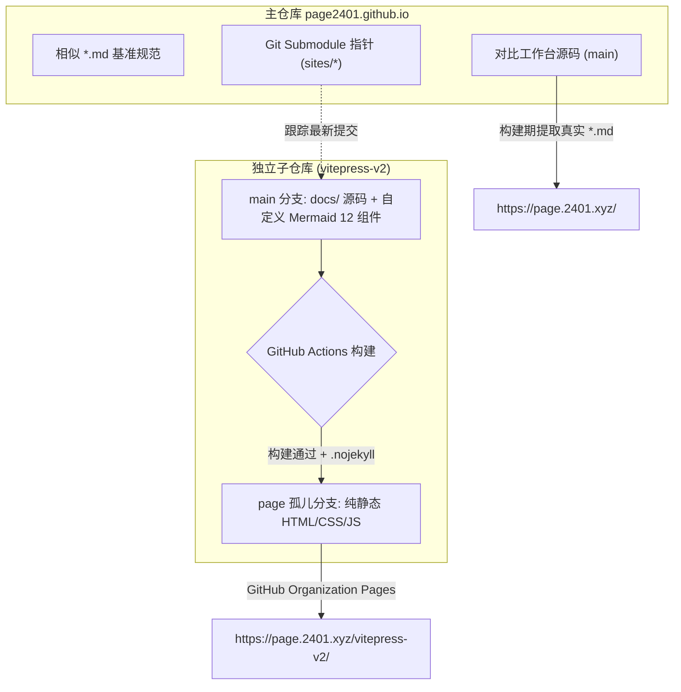
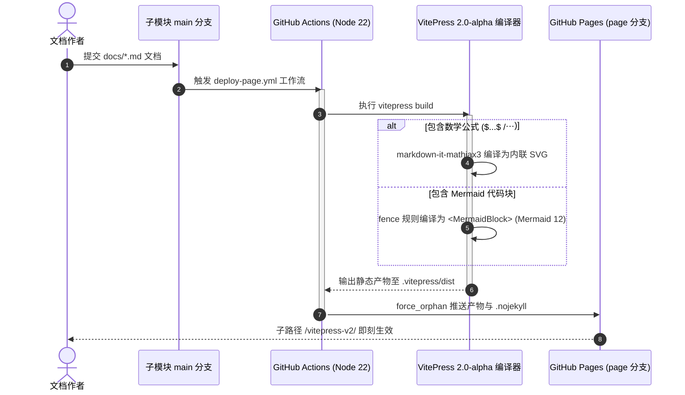
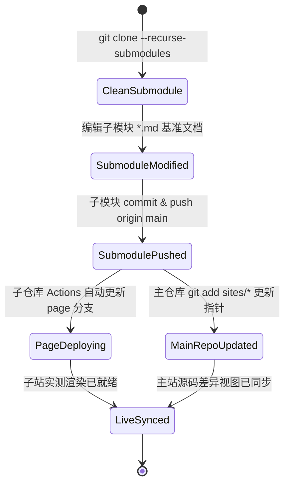

# 02. 流程图与时序图（Mermaid） <Badge type="tip" text="mermaid@12.3.0" />

在大版本升级至 `vitepress@2.0.0-alpha.21` 时，v1 常用的社区插件 `vitepress-plugin-mermaid@2.0.17` 因声明了 `peer vitepress@"^1.0.0"` 而无法直接安装。本子站改为在 `.vitepress/config.mts` 中覆写 `md.renderer.rules.fence` 并挂载 `.vitepress/theme/MermaidBlock.vue` 组件，**仅用 35 行代码便摆脱了三方插件锁死，直接升上最新 `mermaid@12.3.0`**！

## 1. 复杂子图与架构流程图（`flowchart TD`）

## 2. 编译管线交互时序图（`sequenceDiagram`）

## 3. 子模块同步状态机（`stateDiagram-v2`）

